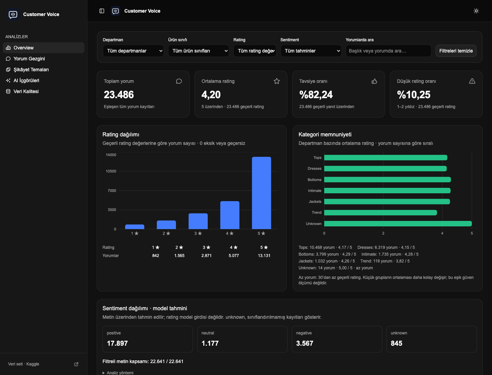

# Customer Voice

Müşteri yorumlarını SQL metrikleri, sentiment tahminleri ve şikâyet temalarıyla inceleyen bir analiz uygulaması. Ürün ve kategori düzeyinde düşük puanlı yorumları önceliklendirir; kaynak metin, model tahmini ve hesaplanan metrikleri ayrı gösterir.

## Analiz kapsamı

| Bölüm | İşlev |
|---|---|
| Overview | Rating, tavsiye oranı, sentiment dağılımı ve ürün inceleme öncelikleri |
| Yorum Gezgini | Ortak filtreler, server-side pagination, kaynak yorum ve TR / EN gösterimi |
| Şikâyet Temaları | Çoklu topic etiketleri, işlenen aday kapsamı ve sınırlı kanıt örnekleri |
| AI İçgörüleri | Hesaplanan kanıtlara bağlı bulgular ve inceleme önerileri |
| Veri Kalitesi | Kaynak dosya ve filtreli veri için eksik/geçersiz alan kontrolleri |

Filtreler `department`, `class_name`, `rating`, `sentiment` ve `search` üzerinden AND ile birleşir. Aynı kapsam KPI, yorum, topic ve özet sorgularında kullanılır. Arama İngilizce kaynak metinde yapılır; çeviriler analiz girdisini değiştirmez.

## Veri ve metrikler

Kaynak: [Women’s E-Commerce Clothing Reviews](https://www.kaggle.com/datasets/nicapotato/womens-ecommerce-clothing-reviews). Ana ekran, bu veri setinin yerel analizini gösterir; ham yorum dosyası ve hesaplanan DB repository’ye dahil edilmez.

| Metrik | Sonuç |
|---|---:|
| Yorum kaydı | 23.486 |
| Metinli yorum | 22.641 |
| Ortalama rating | 4,20 / 5 |
| Tavsiye oranı | %82,24 |
| Düşük rating oranı (1–2) | %10,25 |

Rating metrikleri geçerli 1–5 puanlar; tavsiye oranı geçerli 0/1 yanıtlar üzerinden hesaplanır. Metni boş olan kayıtlar geçerli rating ve recommendation metriklerinde kalır. Payda sıfırsa oran/ortalama `null`, sayım `0` döner. Farklı kaynak ID’lerine sahip içerik tekrarları korunur.

## İşlem yapısı

**CSV → atomik import → SQLite → FastAPI → Next.js.** Sentiment ve topic işleri sonuçlarını sürümlü analysis run’larıyla DB’ye yazar. API yalnızca kaynak checksum’ıyla uyumlu, tamamlanmış seçili run’ı kullanır. Böylece geçmiş ve aktif tahminler birlikte sayılmaz; veri değiştiğinde türetilmiş analizler geçersizleşir.

- **Backend:** Python, FastAPI, SQLite ve parametrik SQL sorguları.
- **Frontend:** Next.js, React, TypeScript, Tailwind CSS, Recharts ve TanStack Table.
- **Sentiment:** yerel Cardiff NLP modeli; immutable revision ve 256 token sınırı.
- **Topic:** sürümlü keyword baseline; beden/kalıp, kumaş, renk/görünüş, stil/tasarım, fiyat/değer, shipping, müşteri hizmetleri ve other.
- **LLM:** özet için NVIDIA Nemotron Lightning, çeviri için ayrı Nemotron Super adapter’ı. Anahtar yoksa özet rules yöntemiyle çalışır.

LLM özetin sayılarını veya metnini serbestçe üretmez. Backend’in hesapladığı kanıta bağlı ifadelerden ID seçer; çıktı şema ve kanıt referanslarıyla doğrulanır. Geçersiz çıktı, timeout veya provider hatasında rules özeti kullanılır. Çeviri cache’i kaynak checksum, model, prompt sürümü ve metin hash’ine bağlıdır.

## Bulguların yorumu

Düşük rating ile negative sentiment aynı ölçüm değildir. Yüksek puanlı bir yorum yerel şikâyet içerebilir; bu nedenle topic adayları düşük rating, negative tahmin veya açık şikâyet ifadesiyle seçilir. Rating–sentiment yön farkı, model hatası skoru yerine kaynak yorumu inceleme sinyali olarak gösterilir.

Ürün öncelikleri en az 10 geçerli rating içeren ürünler arasında düşük rating oranıyla sıralanır. 30 rating altındaki gruplar az yorum olarak işaretlenir. Bu eşikler istatistiksel anlamlılık veya güven garantisi değildir. Çoklu topic sayımları gerçek sorun yaygınlığına eşit değildir; oranların toplamı %100’ü aşabilir.

Sentiment modeli tweet alanında eğitilmiştir; giyim yorumlarında alan farkı vardır. İnsan ground truth olmadığı için accuracy/macro-F1 ölçülmemiştir. Makine çevirisi anlam ve ton hataları içerebilir; İngilizce kaynak erişilebilir kalır. Yorum tarihi ve satış tutarı bulunmadığından zaman trendi, gelir etkisi veya nedensellik çıkarımı yapılmaz.

[Kurulum](docs/SETUP.md) · [Docker](DOCKER.md) · [Güvenlik kapsamı](SECURITY.md) · [Lisans ve atıflar](THIRD_PARTY_NOTICES.md)
